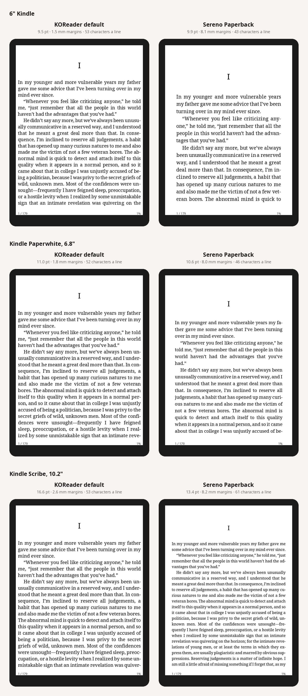
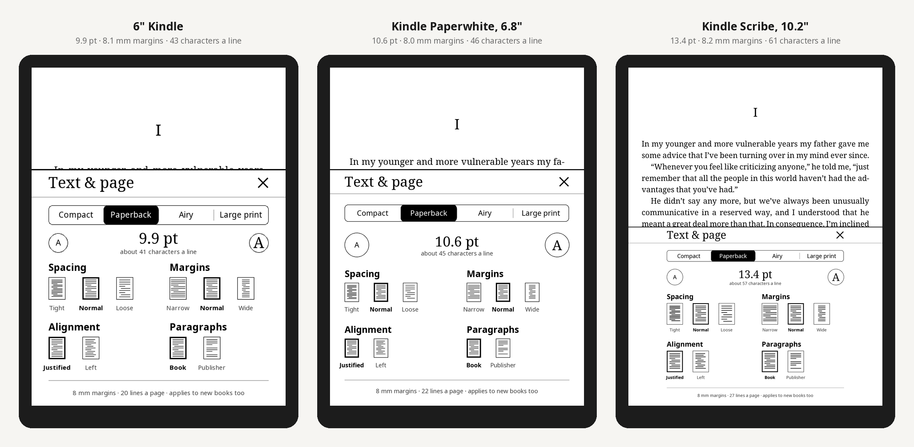

A calmer KOReader: a contextual home screen with real covers, print-like page counts for your whole library, and tiered menus. Nothing in KOReader is patched.

> **Early release.** **It has not yet been tried on a real device.** What has been checked:
> - **Tests:** 147 of them, run on LuaJIT against stubs of KOReader's modules.
> - **Real widget code:** every CI run also draws the home screen with KOReader's own widget code. Please report what you see in [#1](https://github.com/whoismjanyway/sereno/issues/1).

## Install
1. Download **`sereno.koplugin.zip`** below. You can check it against `SHA256SUMS`.
2. Unzip it and copy the `sereno.koplugin` folder into KOReader's `plugins/` folder.
   - **Kindle:** `/mnt/us/koreader/plugins/`
   - **Kobo:** `/mnt/onboard/.adds/koreader/plugins/`
3. Restart KOReader and open **Settings → Sereno**.

To uninstall, turn *Tiered menus* off first (this restores your own menu order file), then delete the folder.

## What's in 0.2.0

### Home screen
- **Contextual:** it changes with what you're doing: continue reading, just finished, start here, empty library.
- **Contents:**
  - the current book in a card, with its real cover, a progress bar and chips (*Page 68 of 179*, *2 h 13 min left*, readability)
  - library tiles: reading, unread, finished
  - a shelf of covers
  - a tab bar with KOReader's icons
- **Covers:** they come from CoverBrowser, or straight from the EPUB when that plugin is off.
- **When it opens:** at start-up or after closing a book (both optional), or from a gesture.

### Fonts, text size and margins
- **Physical sizes:** sizes are in points and millimetres, so text prints at the same size on any screen density.
- **Type scale:** each step is 1.25× the previous one. Noto Serif for titles, Noto Sans for everything else.
- **Margins:** at least 6 mm. On large screens the content column is capped at 110 mm.
- **Spacing:** multiples of 1.5 mm; touch targets at least 7 mm high.
- **Small screens:** the layout gives things up step by step instead of overflowing.

### The page you read
- **Readable margins:** KOReader's defaults leave 1.5–2.6 mm margins and text that grows with the pixel count. Sereno's *Paperback* sets 8 mm margins, a 1.5 line height and about 45 characters a line on a 6–7" screen.
- **Book typography:** indented paragraphs without blank lines, justified and hyphenated text, centred headings, no widows or orphans.
- **Text & page panel:** a Kindle-style panel for layout, text size, spacing, margins, alignment and paragraph style. Each choice is shown as a small page, and the book re-flows as you tap.
- **Applying them:** the open book changes immediately, and new books open the same way. *KOReader's defaults* restores your previous settings.
- **Page numbers that match:** optionally, the reader's page numbers (status bar, *Go to page*) use Sereno's count, so they match the home screen.

### Page counts, words and readability
- **Print model (new):** each book is laid out on a reference paperback page, without opening it. The count stays the same whatever font settings you use.
- **Alternatives:** Calibre's APNX, Adobe and characters-per-page estimates, or a printed-edition count downloaded from Open Library.
- **Words and reading time.**
- **Readability by language:** Flesch / Flesch–Kincaid / Gunning Fog for English, Szigriszt-Pazos (INFLESZ) for Spanish, Amstad for German.
- **Where to see them:** *Pages & readability* in the long-press menu, or hold a book on the home screen. You can also count a whole folder at once.

### Tiered menus (from 0.1)
- **Levels:** Reading, Everyday and Everything, built on KOReader's own menu order file.

### Languages
- English and Spanish.

See the [CHANGELOG](https://github.com/whoismjanyway/sereno/blob/v0.2.0/CHANGELOG.md), the [design notes](https://github.com/whoismjanyway/sereno/blob/v0.2.0/docs/design.md) and [how page counting works](https://github.com/whoismjanyway/sereno/blob/v0.2.0/docs/page-count.md).

**What's next:** see the [roadmap](https://github.com/whoismjanyway/sereno/blob/v0.2.0/docs/roadmap.md) and the [issues](https://github.com/whoismjanyway/sereno/issues).

