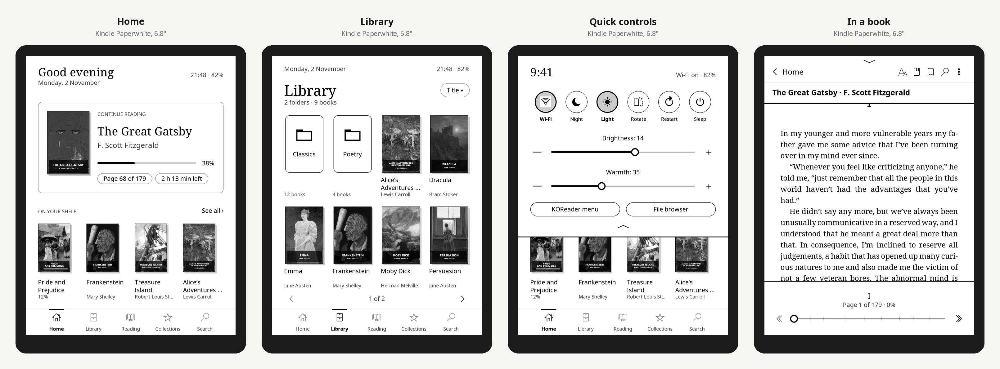
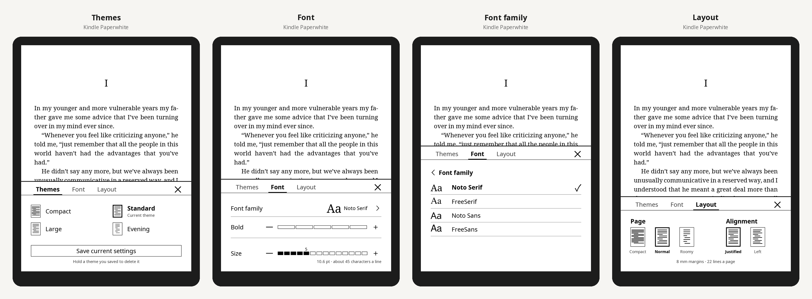
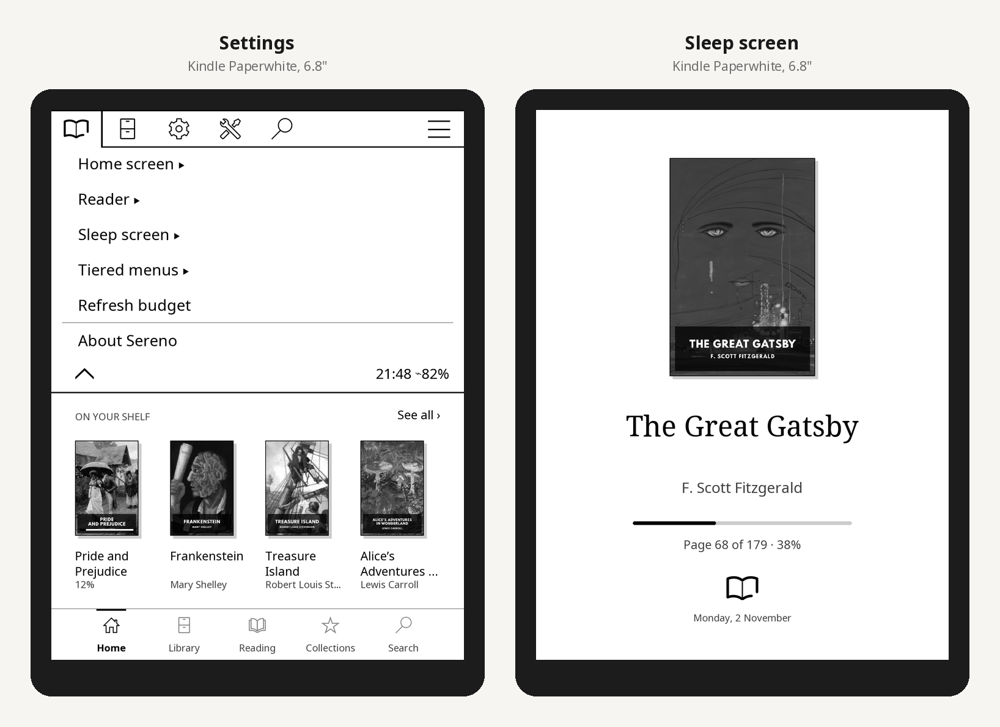

Sereno now replaces KOReader's everyday interface: a full shell with library, reading list, collections and search, quick controls from the top edge, and Kindle-style bars in your books. Nothing in KOReader is patched.

> **Early release, not yet tried on a real device.** Checked with 186 tests, against KOReader's latest release, on LuaJIT against stubs of KOReader's modules, and every screen is drawn with KOReader's own widget code in CI. Please report what you see in [#1](https://github.com/whoismjanyway/sereno/issues/1).

## Install
1. Download **`sereno.koplugin.zip`** below (check it against `SHA256SUMS`).
2. Unzip it and copy the `sereno.koplugin` folder into KOReader's `plugins/` folder, replacing any older one.
   - **Kindle:** `/mnt/us/koreader/plugins/`
   - **Kobo:** `/mnt/onboard/.adds/koreader/plugins/`
3. Restart KOReader. Sereno's home screen opens.

## What's new in 0.3.0
- **One shell:** Home, Library, Reading, Collections and Search all stay in Sereno. Folders are tiles, books are covers, a page of covers per screen (swipe to turn), sorting by title, author or date.
- **Quick controls:** swipe down from the top edge for Wi-Fi, night mode, light, rotation, restart, sleep, and brightness and warmth sliders. *KOReader menu* and *File browser* are always there.
- **Bars in the book:** tap the top or bottom of a page for Home, Text & page, contents, bookmarks, search and KOReader's menu, plus a progress slider with chapter marks, chapter skips and *Back to page …*. Tap the middle of the page to hide them.
- **One settings screen:** *Settings* in the quick controls (or ⋮ in a book) opens Sereno's tab, marked with Sereno's book logo, followed by all of KOReader's tabs, unchanged.
- **Sleep screens:** KOReader's own sleep screens (covers, your images, messages) keep working. Sereno closes its sheets before sleep and redraws cleanly on wake. New, optional: *Sleep screen → Sereno: cover and progress*.
- **Fixed:** page counts and stable page numbers now work on KOReader releases (EPUBs were reported as "no META-INF/container.xml").
- **Fixed:** *Home* in a book now always goes to Sereno's home screen, never out to the Kindle's own home.
- **Text panel (Aa) in three tabs:** Themes (Compact, Standard, Large, and your own saved settings), Font (family, Bold, a numbered Size bar) and Layout (page and alignment).
- **Short selection menu:** Highlight, Note, Dictionary and More….
- **Page numbers that don't move:** counted by text, not by screens, so they stay the same whatever font or size you choose. Pages like the printed book (default), or *Locations* like a Kindle (one per 128 characters).
- **To get KOReader's own menus back in books:** *Settings → Sereno → Sereno's bars in books*.

From 0.2: readable margins and book typography, the Text & page panel, print-like page counts and readability, tiered menus. See the [CHANGELOG](https://github.com/whoismjanyway/sereno/blob/v0.3.0/CHANGELOG.md).
