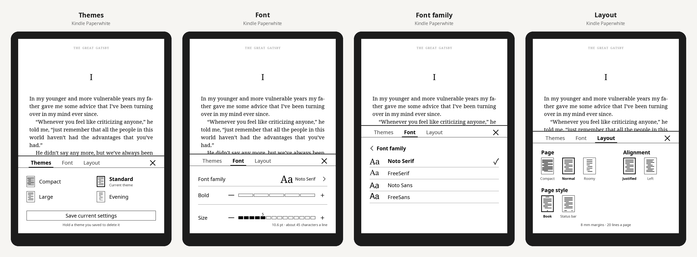

Sereno 0.4.0 comes from testing 0.3 on a real Kindle: EPUB page counts and stable page numbers now work on KOReader's releases, *Home* always returns to Sereno, and the text settings follow the Kindle's own panel in three tabs. Nothing in KOReader is patched.

> Checked with 186 tests against KOReader's latest release (v2026.07.2), and every screen is drawn with KOReader's own widget code in CI. Please report what you see in [#1](https://github.com/whoismjanyway/sereno/issues/1).

## Install
1. Download **`sereno.koplugin.zip`** below (check it against `SHA256SUMS`).
2. Unzip it and copy the `sereno.koplugin` folder into KOReader's `plugins/` folder, replacing the older one.
   - **Kindle:** `/mnt/us/koreader/plugins/`
   - **Kobo:** `/mnt/onboard/.adds/koreader/plugins/`
3. Restart KOReader.

## Fixed
- **EPUBs couldn't be counted** ("Could not count this book: no META-INF/container.xml"). Page counts, readability and covers now work on every EPUB.
- **Stable page numbers failed on KOReader releases** ("Page numbers can only be set for reflowable books"). They now work on releases, so the status bar shows numbers that don't change with font or size.
- **Home in a book quit to the Kindle's own home screen** when KOReader had started straight into the book. It now always goes to Sereno's home screen.
- The home screen follows rotation; the *previous chapter* arrow is dimmed at the start of a book.

## New
- **Text panel (Aa) in three tabs:**
  - *Themes:* Compact, Standard, Large, and your own (*Save current settings*; hold one to delete it).
  - *Font:* the font family written in its own typeface, with a list of every font; a *Bold* bar; a numbered *Size* bar.
  - *Layout:* the page (Compact, Normal, Roomy) and the alignment.
- **Short selection menu:** Highlight, Note, Dictionary and More…. One switch in Settings brings back KOReader's full list.
- **Locations, like a Kindle:** *Page counts → Show locations* for "Location 452 of 3,400" (one per 128 characters), or keep pages like the printed book.

## Changed
- Page numbers that don't move are always on, applied when a book opens.
- Simpler page counts menu, and simpler reading settings (justified text and book-style paragraphs are two switches).

See the [CHANGELOG](https://github.com/whoismjanyway/sereno/blob/v0.4.0/CHANGELOG.md).
