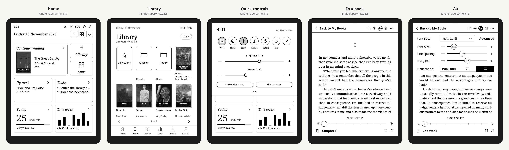
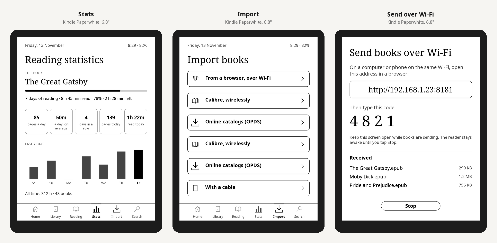

Sereno 0.5.0 makes the page look like a printed book's and adds two tabs: your reading statistics, and ways to import books. Nothing in KOReader is patched.

> Checked with 257 tests against KOReader's latest release, and every screen is drawn with KOReader's own widget code in CI. Please report what you see in [#1](https://github.com/whoismjanyway/sereno/issues/1).

## Install
1. Download **`sereno.koplugin.zip`** below (check it against `SHA256SUMS`).
2. Unzip it and copy the `sereno.koplugin` folder into KOReader's `plugins/` folder, replacing the older one (Kindle: `/mnt/us/koreader/plugins/`, Kobo: `/mnt/onboard/.adds/koreader/plugins/`).
3. Restart KOReader.

## Fixed
- **Exit now leaves KOReader** for the Kindle's own home screen (from KOReader's menu, or the new *Exit* button in the quick controls).
- **After reading, you go straight to Sereno's home screen**, never KOReader's file browser.

## New
- **A home screen of tiles**, like a modern e-reader's: Continue reading, Library, Apps, Up next, your Tasks, Today (your reading against a daily goal, with your streak) and This week's reading time.
- **Kindle-style bars in books:** *Back to My Books*, rotate, light, **Aa**, settings at the top; *PAGE 141 OF 3,255*, a slider, chapter skips, the chapter, bookmarks and search at the bottom.
- **Aa drops down under the top bar** with font face, size, line spacing and margin sliders, and justification. *Advanced* has the themes, bold and page style.
- **A book page:** the title in spaced capitals at the top, the page number centred at the foot, KOReader's status bar out of the way. Prefer the status bar? *Aa → Layout → Page style → Status bar*.
- **Stats:** this book's days of reading, time read and time left; pages and time a day over the last week; days in a row; today; the last seven days as bars; all time. It comes from KOReader's Reading statistics (turn it on in Tools if it's off).
- **Import:**
  - **From a browser, over Wi-Fi:** the reader shows an address and a code. Open it on your computer or phone (same Wi-Fi), type the code and drop books in, and KOReader stays open.
  - **From calibre over Wi-Fi and online catalogs** (Project Gutenberg, Standard Ebooks, your calibre server or any OPDS catalog you add), through KOReader's calibre and OPDS plugins.

## Changed
- Tabs: Home, Library, Reading, Stats, Import, Search. Collections are now the Library's first tile.

See the [CHANGELOG](https://github.com/whoismjanyway/sereno/blob/v0.5.0/CHANGELOG.md).
