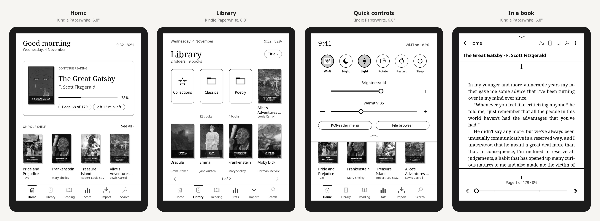
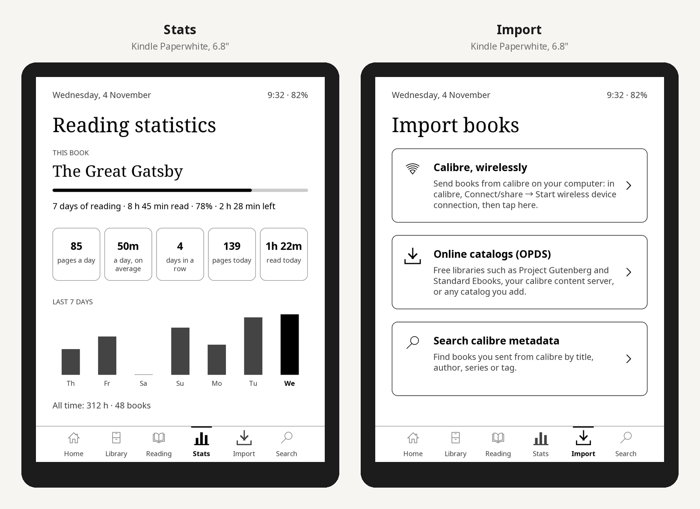

Sereno 0.5.0 makes the page look like a printed book's and adds two tabs: your reading statistics, and ways to import books. Nothing in KOReader is patched.

> Checked with 190 tests against KOReader's latest release, and every screen is drawn with KOReader's own widget code in CI. Please report what you see in [#1](https://github.com/whoismjanyway/sereno/issues/1).

## Install
1. Download **`sereno.koplugin.zip`** below (check it against `SHA256SUMS`).
2. Unzip it and copy the `sereno.koplugin` folder into KOReader's `plugins/` folder, replacing the older one (Kindle: `/mnt/us/koreader/plugins/`, Kobo: `/mnt/onboard/.adds/koreader/plugins/`).
3. Restart KOReader.

## New
- **A book page:** the title in spaced capitals at the top, the page number centred at the foot, KOReader's status bar out of the way. Prefer the status bar? *Aa → Layout → Page style → Status bar*.
- **Stats:** this book's days of reading, time read and time left; pages and time a day over the last week; days in a row; today; the last seven days as bars; all time. It comes from KOReader's Reading statistics (turn it on in Tools if it's off).
- **Import:** from calibre over Wi-Fi, from online catalogs (Project Gutenberg, Standard Ebooks, your calibre server or any OPDS catalog you add), calibre metadata search, and where to copy books with a cable. It uses KOReader's calibre and OPDS plugins.

## Changed
- Tabs: Home, Library, Reading, Stats, Import, Search. Collections are now the Library's first tile.

See the [CHANGELOG](https://github.com/whoismjanyway/sereno/blob/v0.5.0/CHANGELOG.md).
