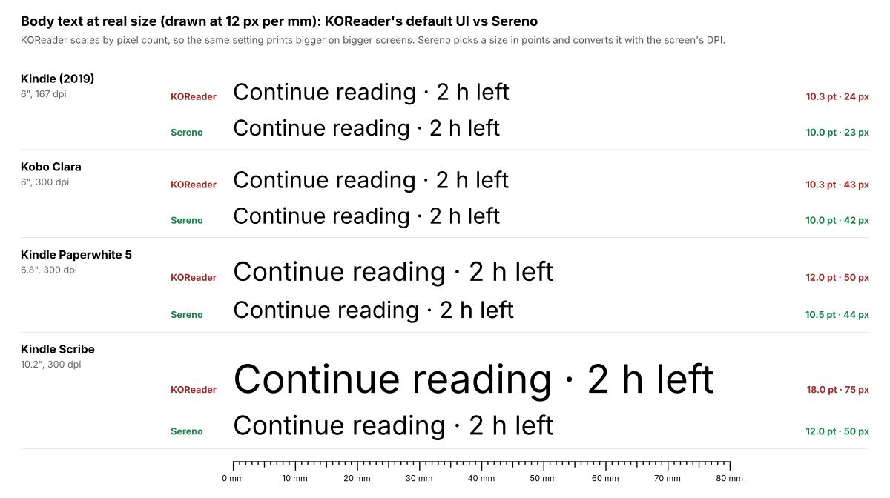
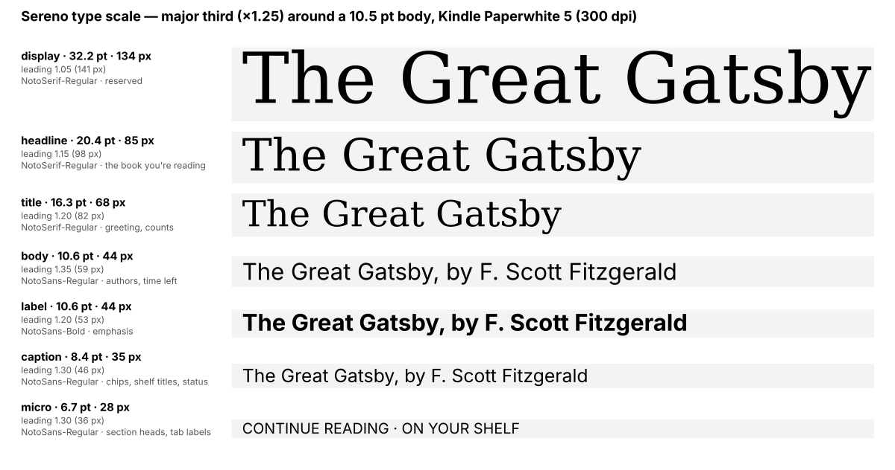
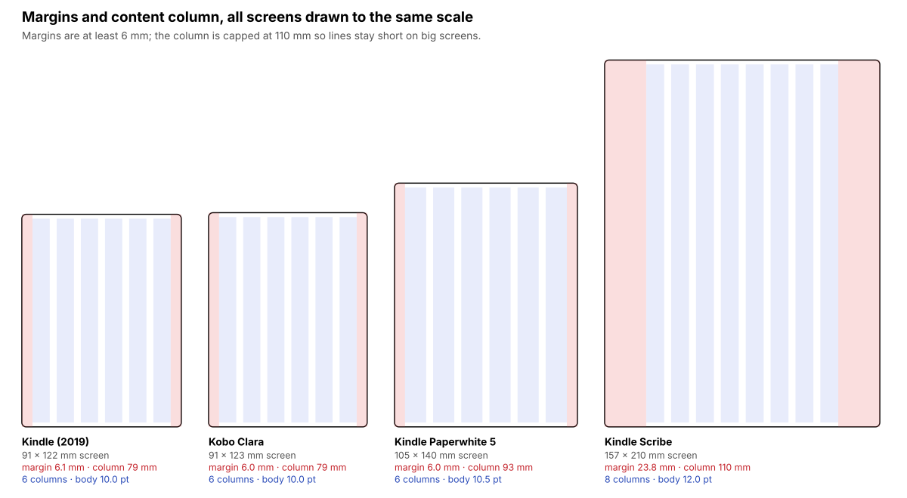
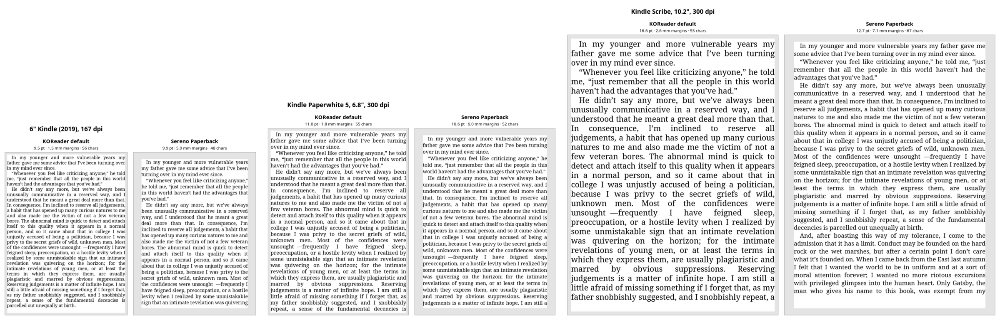

# Sereno

**A calmer interface for [KOReader](https://koreader.rocks), without patching KOReader.**

Sereno is a KOReader plugin with three parts:

- **A contextual home screen** designed from the physical size of your screen, not its pixel count.
- **Print-like page counts, word counts and readability** for every book in your library, computed without opening the books.
- **Tiered menus** that hide what you don't need, using KOReader's own menu-order mechanism.


*The last row is not a mock-up. `tools/korender` draws it with KOReader's own blitbuffer, FreeType fonts, TextBoxWidget and IconWidget, and Sereno's HomeScreen widget.*

*Previews rendered by `tools/preview.lua`: a Kindle Paperwhite 5 (top), then a 6" Kindle, a Kindle Scribe and a colour e-ink screen. The covers are the real ones, taken out of each EPUB by Sereno's own reader, from [Standard Ebooks](https://standardebooks.org) editions.*

**What's on the screen**, from top to bottom:
- **Header:** a greeting in serif and the date. Small screens get a single line with the date, clock and battery.
- **Book card:** the book you're reading, with its real cover and a progress bar. Short facts sit in chips: *Page 68 of 179*, *2 h 13 min left*, the readability.
- **Library tiles:** books being read, unread and finished. They become one line, or disappear, when space is short.
- **Shelf:** real covers, with progress bars on books in progress, and *See all* to open the library. Large screens get two rows.
- **Tab bar:** KOReader's own icons with words under them; the active tab is marked.

## Why another interface plugin?

[SimpleUI](https://github.com/doctorhetfield-cmd/simpleui.koplugin) and [ZenOS](https://github.com/xZenLabs/zen-os) both made KOReader friendlier. Sereno tries to fix what they share:

| | SimpleUI / ZenOS | Sereno |
|---|---|---|
| **How it hooks in** | They patch KOReader internals (CoverBrowser), so they can't be installed together and break when KOReader changes. | It uses only public extension points: the per-user menu order file, file-dialog buttons, dispatcher actions and its own widget. |
| **Sizing** | Pixel-based, through KOReader's `scaleBySize`. The same theme looks big on a 6" Kindle and small on a 10" Scribe. | Millimetres and points: the same printed text size on every device. There is a modular type scale, 6 mm minimum margins and 7 mm touch targets. |
| **Home screen** | A dashboard of many widgets. | One focal point (the book you're reading) and a shelf. The layout adapts to the screen instead of overflowing. |
| **E-ink** | Each widget refreshes on its own. | One coordinator groups refreshes. Only the clock line repaints, once a minute, and pauses during sleep. |
| **Page numbers** | Whatever KOReader shows, which changes with every font change. | A stable *print-model* count, the same for every reading setting. See [Page counts](#page-counts). |

## Fonts, text size and margins

Sereno sizes everything in points and millimetres, then converts to pixels with the screen's DPI. Text therefore prints at the same size on a 167 dpi Kindle and a 300 dpi Paperwhite, and big screens get wider margins instead of giant letters.

**Text size.** Below, body text is drawn at real size on four devices. KOReader's default interface text grows with the pixel count: 10.3 pt on a 6" Kindle, 18 pt on a Kindle Scribe. Sereno picks 10–12 pt by screen diagonal.



**Fonts.** Every style comes from one scale: each step is 1.25× the previous one, around the body size.

| Font | Used for |
|---|---|
| Noto Serif | Book titles, the greeting and the counts, like a cover or a title page |
| Noto Sans | Everything else |

Both fonts ship with KOReader.



**Margins and grid.** The content sits in a column with at least 6 mm of margin, capped at 110 mm wide so lines stay readable on large screens.

| | Small screens | Large screens |
|---|---|---|
| Grid | 6 columns | 8 columns |
| Gutter | 4 mm | 4 mm |

All vertical spacing is a multiple of 1.5 mm, and touch targets are at least 7 mm high.



The overlay below is drawn on the real home screen, on a Kindle Paperwhite and on a 6" Kindle:
- **Red:** margins
- **Blue:** grid columns
- **Cyan lines:** the 1.5 mm baseline unit
- **Green dashes:** touch targets


To make these images yourself, run `luajit tools/specimen.lua out/`. For the overlays, run `SERENO_PREVIEW_GRID=1 luajit tools/preview.lua out/ books/`. There is more in [docs/design.md](docs/design.md).

## The page you read

KOReader sets the reader's font size and margins in "relative pixels" that grow with the screen's pixel count. With its defaults:

| Device | Text | Side margins |
|---|---|---|
| 6" Kindle | 9.5 pt | 1.5 mm |
| Paperwhite 5 | 11 pt | 1.8 mm |
| Kindle Scribe | 16.6 pt | 2.6 mm |

So the text changes size from device to device, and the margins stay a hair wide everywhere.

**Settings → Sereno → Reading layout** offers four layouts defined in points and millimetres, converted to KOReader's units for your screen:

| Layout | Text | Side margins | Line length | Line spacing |
|---|---|---|---|---|
| Compact | base − 0.5 pt | 4 mm | ≤ 75 characters | 100 % |
| **Paperback** | base | 6 mm | ≤ 68 characters | 110 % |
| Airy | base + 0.5 pt | 9 mm | ≤ 60 characters | 125 % |
| Large print | base + 4 pt | 6 mm | ≤ 50 characters | 115 % |

The base size depends on the screen: 10 pt on 6", 10.5 pt on 7", 11.5 pt on 8", 12.5 pt on larger screens. When a line would run longer than the layout's limit, the margins grow instead.

How a layout is applied:
- **Open book:** it changes immediately, through the same events as KOReader's own bottom menu, so KOReader's sliders show the new values.
- **New books:** they open with it, through KOReader's own default settings.
- **Going back:** choosing *KOReader's defaults* restores whatever defaults you had before.

The first page of *The Great Gatsby* at real size, KOReader's defaults next to Sereno's *Paperback* (margins shaded):



*Text set with KOReader's own font renderer by `tools/korender`. KOReader lays out books with crengine, which also hyphenates, so its line breaks differ a little. The status bar is not shown.*

**Page numbers that match.** Turn on *Page counts → Use these page numbers in the reader*. Sereno then tunes KOReader's own stable page numbers so each book has exactly the pages shown on the home screen. The status bar and *Go to page* use the same numbers, whatever your font settings. Books with publisher page numbers keep them.

## Page counts

KOReader numbers pages as they are laid out on your screen. Change the font size and *page 120 of 340* becomes *page 180 of 512*. Its synthetic page map, which cuts the text every 1500 characters, is stable but only exists once a book has been opened.

Sereno reads the EPUB directly and estimates pages the way [Calibre's Count Pages](https://github.com/kiwidude68/calibre_plugins/wiki/Count-Pages) does, so it works for a whole library at once. It adds its own estimator:

- **Print model** (default): Sereno *typesets* the book on a reference paperback page (64 characters × 32 lines).
  - Words wrap; every paragraph starts a new line.
  - Headings and images take room; chapters start on a fresh page.
  - Dialogue-heavy and illustrated books therefore get the extra pages they really use in print.
- **Printed edition**: downloaded from Open Library, either for the book's ISBN or as the median of all editions of the work.
- **Calibre APNX**, **Adobe Digital Editions** and **characters per page (1500)**: re-implementations of the classic estimators, kept for comparison.

The book's position is mapped onto the chosen count, so the home screen says *Page 68 of 179 · 38%*, and keeps saying it whatever font you pick.

| Book (Standard Ebooks) | Print model | APNX | Adobe | 1500 chars | Words | Readability |
|---|---|---|---|---|---|---|
| The Great Gatsby | **179** | 181 | 132 | 180 | 49,153 | Fairly easy (Flesch 75) |
| Pride and Prejudice | **434** | 386 | 354 | 457 | 122,692 | Standard (64) |
| Frankenstein | **268** | 229 | 220 | 293 | 78,619 | Fairly demanding (60) |
| Treasure Island | **247** | 218 | 209 | 242 | 69,109 | Easy (80) |
| Alice's Adventures in Wonderland | **125** | 101 | 87 | 101 | 28,116 | Easy (81) |

The Scribner paperback of *The Great Gatsby* has 180 pages. Each count takes 0.1–0.2 s on a desktop computer. Details and calibration are in [docs/page-count.md](docs/page-count.md).

**Readability** uses the formula made for each language:
- **English:** Flesch, Flesch–Kincaid and Gunning Fog
- **Spanish:** Szigriszt-Pazos on the INFLESZ scale
- **German:** Amstad

Long-press a book in the file browser, or hold it on the home screen, to see every number side by side.

## Install

1. Download `sereno.koplugin.zip` from the [latest release](https://github.com/whoismjanyway/sereno/releases/latest), unzip it, and copy the `sereno.koplugin` folder into KOReader's `plugins/` folder.
   - **Kindle:** `/mnt/us/koreader/plugins/`
   - **Kobo:** `/mnt/onboard/.adds/koreader/plugins/`
2. Restart KOReader.
3. Open **Settings → Sereno**:
   - **Home screen** shows it now. You can also turn on *Start with the home screen*.
   - **Page counts → Count all books in this folder** counts the whole library once.
   - **Tiered menus** lets you choose *Reading*, *Everyday* or *Everything*.

Covers come from KOReader's CoverBrowser cache when that plugin is on. Otherwise Sereno renders the cover image stored inside the EPUB itself, keeping at most 16 in memory. To uninstall, turn tiered menus off first (that restores your own menu order file), then delete the folder.

> **Status:** 0.2, early. **It has not yet been tried on a real device.** What has been checked:
> - **Specs:** run on LuaJIT with stubs of KOReader's modules.
> - **Real widget code:** the home screen is also drawn by KOReader's own code (blitbuffer, FreeType fonts, TextBoxWidget, IconWidget) on every CI run, with `tools/korender`.
> - **Previews:** layout previews for several devices. Please report what you see; see [CONTRIBUTING.md](CONTRIBUTING.md).

## Develop

```sh
git clone --depth 1 https://github.com/koreader/koreader.git ../koreader   # optional: real default menus
KOREADER_DIR=../koreader luajit spec/run.lua                               # all specs
luajit tools/count.lua path/to/book.epub                                   # page counts from the command line
luajit tools/preview.lua previews && rsvg-convert -o p.png previews/paperwhite-reading.svg
KORENDER_READER=1 tools/korender/run.sh out/ books/                       # draw with KOReader's real widgets
```

- **Code layout:** [docs/architecture.md](docs/architecture.md)
- **Design decisions:** [docs/design.md](docs/design.md)
- **What's next, broken into small parts:** [docs/roadmap.md](docs/roadmap.md)

## Credits and license

- **Algorithms:** the APNX, Adobe and characters-per-page estimators follow Grant Drake's Count Pages plugin for Calibre (GPL-3.0).
- **Prior work:** thanks to the KOReader, SimpleUI and ZenOS projects for showing what people want from their e-readers.
- **Sample books:** the preview covers come from [Standard Ebooks](https://standardebooks.org). Their cover art is in the public domain, and their cover designs are dedicated to the public domain under CC0.
- **Icons:** the tab bar uses KOReader's own icon set.
- **License:** Sereno is licensed under the AGPL-3.0, like KOReader.
