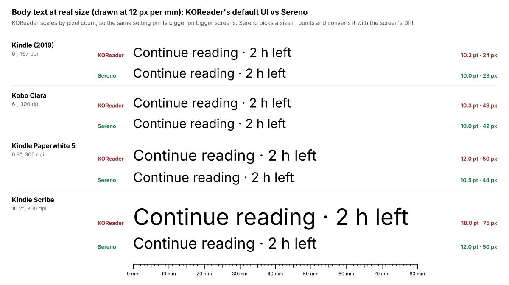
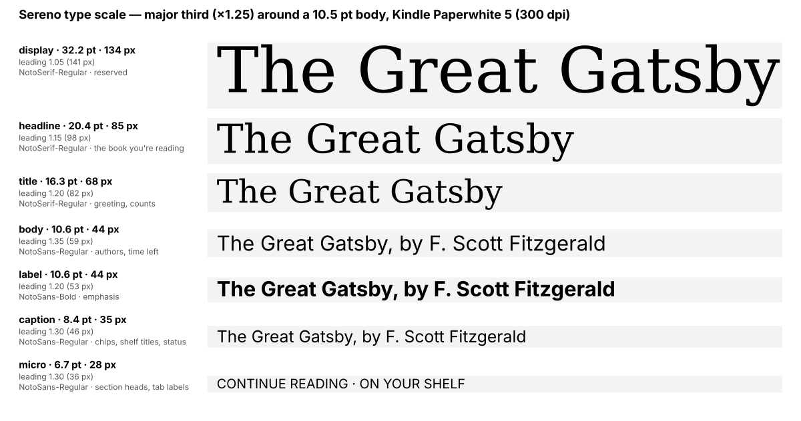
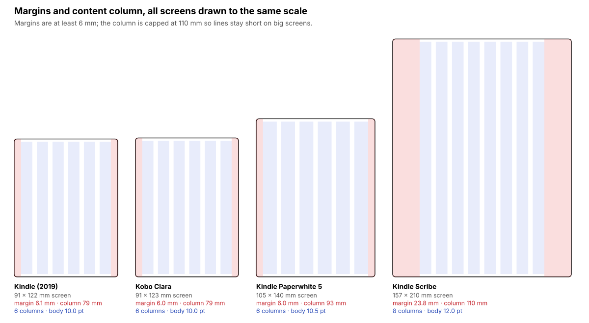
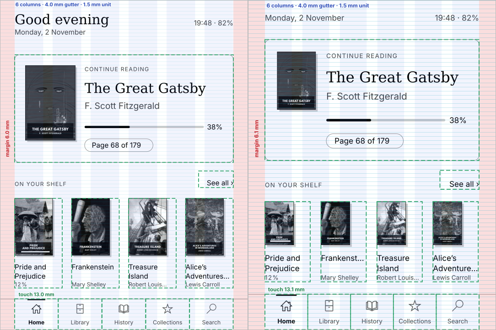
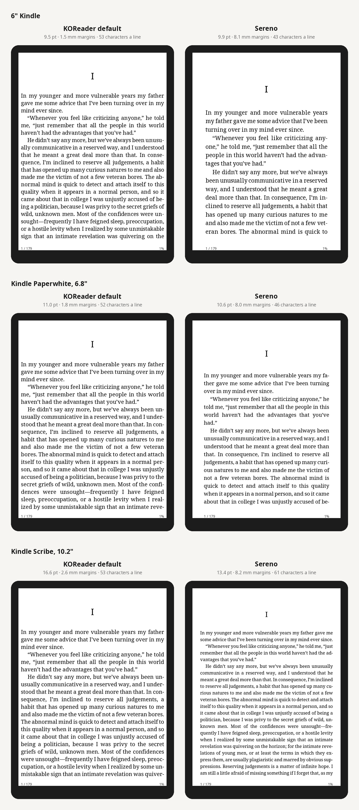
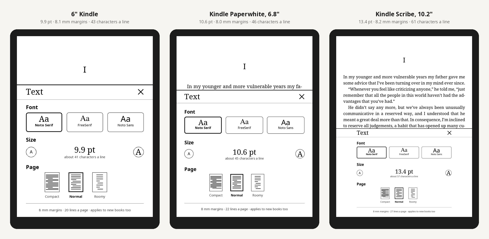

# Design notes

## Start from the physical screen

KOReader sizes interface fonts with `Screen:scaleBySize`, which multiplies by `min(width, height) / 600` and ignores DPI unless the user overrides it. The same "size 24" font therefore ends up very different on different devices:

| Device | Screen | KOReader UI body text |
|---|---|---|
| Kindle (2019) | 600 px wide at 167 dpi | 24 px ≈ 10 pt |
| Kindle Scribe | 1860 px wide at 300 dpi | 75 px ≈ 18 pt |

`sereno/ui/theme.lua` starts from millimetres and points instead:

- **Body size** comes from the screen diagonal: 10 pt below 6.5", 10.5 pt up to 7.5", 11 pt up to 9", 12 pt above.
- **Type scale:** a major third (×1.25).
  - **micro** (−2): running heads and meta.
  - **caption** (−1): status and shelf titles.
  - **body**.
  - **title** (+2).
  - **headline** (+3): the book you're reading.
  - **display** (+5): reserved.
- **Leading:** 1.35 for body text, tightening to 1.05 for display sizes.
- **Spacing:** one baseline unit of 1.5 mm. Every gap is a multiple of it.
- **Margins:** at least 6 mm. On large screens the content column is capped at 110 mm (portrait) or 180 mm (landscape), so lines stay readable and the margins grow instead.
- **Grid:** 6 columns (8 on large or landscape screens) with 4 mm gutters.
- **Touch targets:** at least 7 mm high.
- **Ink:** black text, plus only two greys, `#444` and `#888`. Light-grey text dithers badly on 16-level panels, so there is none.
- **Fonts:** serif (Noto Serif) for book titles, like a cover or a title page, and sans (Noto Sans) for interface text. Both ship with KOReader.

To get exact pixel sizes through `Font:getFace`, the theme divides by KOReader's scale factor (`Theme:faceSize`).

## One focal point

The home screen answers one question first, "where was I?", and then offers a few next books. It is contextual rather than a grid of widgets:

| State | Hero | Shelf |
|---|---|---|
| Reading | The current book: page *n of N* in stable print pages, a progress rule, time left at your reading speed, readability | "On your shelf": other books in progress, then new ones |
| Finished | The book you finished: its length and reading time, and "Next: …" | "Up next": the next book in the series, then new books |
| Start | The newest unread book | "Up next" |
| Empty | A short note on how to add books | — |

## The page you read

The reader has the same problem as the interface. KOReader stores the font size and margins in relative pixels (`Screen:scaleBySize`). With the defaults (font 22, margins 10), text is set at 9.5 pt with 1.5 mm side margins on a 6" Kindle, and at 16.6 pt with 2.6 mm margins on a Kindle Scribe. The text runs almost to the bezel.

`sereno/reader/layout.lua` keeps the choices to what a reader changes while reading, like the Kindle's *Aa* panel:

| Choice | Values |
|---|---|
| Font | Any font KOReader has; the panel offers up to four, each written in its own typeface |
| Size | Points, in half steps around a base set by the diagonal (10 / 10.5 / 11.5 / 13.5 pt) |
| Page | Compact, Normal, Roomy. Each pairs margins (5 / 8 / 14 mm, with a line-length cap of 75 / 66 / 58 characters, so on big screens the margins grow instead of the lines) with line spacing (crengine's 100 / 110 / 125 %, which is 1.36 / 1.5 / 1.7 em with Noto Serif) |

Justified text and book-style paragraphs (KOReader's style tweaks for first-line indents, no paragraph gaps, centred headings, no widows and orphans, hyphenation) are on by default and are two switches in Settings.

Values are converted back to KOReader's units for the screen at hand, and applied through KOReader's own events (`SetFontSize`, `SetLineSpace`, `SetPageMargins`) and `ReaderStyleTweak`'s global tweaks. Only the axis that changed is sent, so one tap re-flows the book once. New books get the same through KOReader's `copt_*` defaults and `style_tweaks`, after the user's previous values are kept aside.

The *Text* panel (`sereno/reader/panel.lua`) is a bottom sheet that leaves most of the page in view while it re-flows: Font, Size and Page, nothing else. Each page choice is drawn as a miniature page with the real proportions of that option; the selected one gets a heavy border, like the Kindle's. In landscape, Size and Page share a row.

## Position

A printed page has no fixed size on a screen, so Sereno numbers your position by the text: KOReader's synthetic page map (crengine cuts the text by characters, not by screens) is tuned to the book's print-like page count. *Pages* reads the page from it; *Locations*, like a Kindle, turns the same character position into one location per 128 characters. Neither changes with the font, size or margins.

## The pieces

The design takes the structure that works in modern reading apps and translates it for e-ink:

| Piece | On screen | E-ink translation |
|---|---|---|
| **Card** | The book you're reading sits in a card with 2 mm rounded corners and a hairline border. | No shadows on the card itself. |
| **Cover shadow** | Every cover casts a small offset shadow. | A flat grey block 0.8 mm down and right, instead of a blur, which e-ink can't render cleanly. |
| **Chips** | Short facts in pill outlines: page, time left, readability. | Outlines only, no filled backgrounds, so text stays black on white. |
| **Tiles** | Library counts in three equal tiles, with the number in serif and the label in small capitals. | Same outline treatment as chips. |
| **Shelf** | Real covers on a common baseline. Books in progress get a thin progress bar laid over the bottom of the cover, white track and black fill. | The bar stays readable over dark covers. |
| **Tab bar** | KOReader's own outline icons with a word under each. | The active tab gets bold text, full-black ink and a short rule on top; the others are dimmed. |

Covers come from CoverBrowser's cache, or Sereno renders the EPUB's own cover image (EPUB 3 `cover-image`, EPUB 2 `<meta name="cover">`, or a file named "cover"). Without either, it draws a typeset cover.

## Fit the screen, never overflow

`sereno/home/layout.lua` works to a vertical budget. It tries the richest arrangement first, then gives things up in this order:

1. **Shelf rows:** on screens taller than 18 cm, two rows of the shelf first, then one.
2. **Library counts:** the tiles first, then the same counts on one line, then none. The shelf keeps covers at 75 % or more while counts are shown.
3. **Gaps:** they tighten from 5 to 4 to 3 units.
4. **Header:** screens shorter than 13.5 cm always use the one-line header instead of the greeting.

Within the space left, the book card tries variants from generous to compact until one fits:

1. 3-line title, full cover, two rows of chips
2. 2-line title
3. smaller cover, one row of chips
4. smaller title style
5. smallest cover

With no counts shown, shelf covers may shrink to 60 % before the shelf disappears. A long title drops its subtitle ("Frankenstein; or, The Modern Prometheus" → "Frankenstein") rather than being cut mid-phrase.

On a device the layout measures text with KOReader's own shaping (`TextBoxWidget`), so the boxes match the glyphs. In previews and tests it uses an estimate. `spec/home_spec.lua` checks every state on seven screen sizes for nodes that leave the screen or overlap, and that both the hero and the shelf are present.

## Refresh as a budget

E-ink refreshes are slow and visible. The home screen paints once with a `flashui` refresh on open, then only the status line changes: one `ui` refresh a minute, driven by the shared, minute-aligned timer in `sereno/eink/refresh.lua`. The timer pauses while the device sleeps or another window covers the home screen. Counting books in the background triggers a single repaint at the end, not one per book.

## Copy

- **Plain words:** *Continue reading*, *About 2 h 13 min left*, *Fairly easy read*. Icons only where a word goes with them, as in the tab bar.
- **Translatable as a whole:** all strings go through `sereno/l10n`, and a spec checks every translation is complete and keeps its placeholders.
